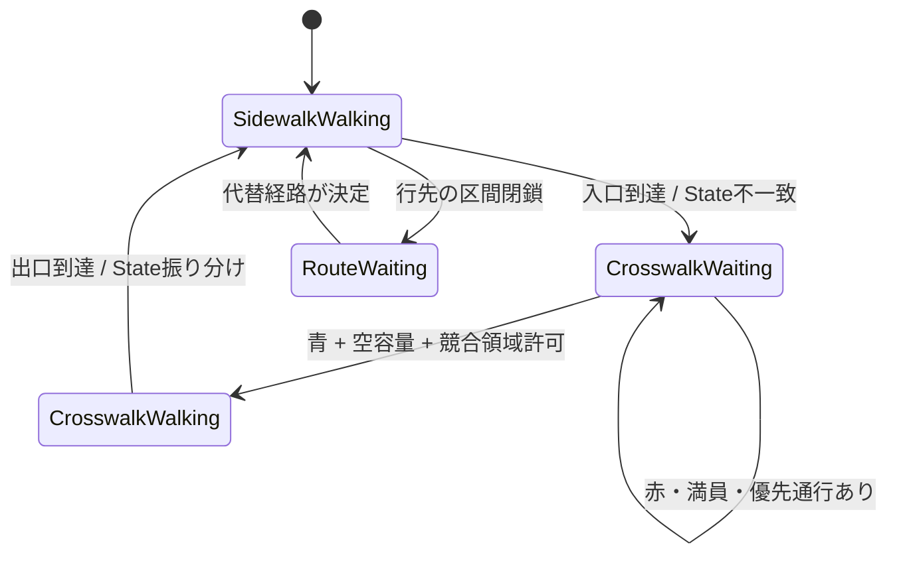

# 交通・横断歩道の縦断仕様 v0.2

> 目的: [#23 交差点](https://github.com/tomiya7688/city-builder/issues/23)、[#24 歩道](https://github.com/tomiya7688/city-builder/issues/24)、[#25 車](https://github.com/tomiya7688/city-builder/issues/25)、[#26 歩行者](https://github.com/tomiya7688/city-builder/issues/26)、[#64 境界リクエスト](https://github.com/tomiya7688/city-builder/issues/64) の最小縦断を具体化する。ランタイム共通契約は [RUNTIME_PROTOCOL.md](RUNTIME_PROTOCOL.md)。**実装前のルール仕様**であり、現在のゲーム挙動の記録ではない。

## 1. 道路を「区間内の移動」と「境界での通行判定」に分ける

最小グラフ:

```text
歩道A ── (横断歩道の入口) ── 横断歩道X ── (出口) ── 歩道B
                         ╳ 競合領域C
車道R ── (停止線) ─────────────────────────────── 車道S
```

区間内は走行/歩行の共通移動規則で進捗を予測し、**次の境界に到着したときだけ**進入要求を提出する。

- `SegmentId`: 有向の歩道、横断歩道、車線、歩道橋等。区間には距離/速度ルール/占有容量を持たせる。
- `BoundaryId`: どの区間から次の区間へ入るか、進入できるState、信号、優先、競合条件を持たせる。
- `ConflictZoneId`: 横断する歩行者と車が同時に占有してはならない物理的な領域。複数の境界が同じ競合領域の許可を参照する。
- `TripRoute`: 目的地に向けて歩道、交差点、駅等を選ぶ経路。**Stateが変わっただけでは経路全体を毎回再探索しない**。閉鎖や経路失効なら経路探索を起動する。

曲がり角で右折/左折/直進が分かれる場合は、各IDの次境界と進路を残す。同一グループの歩行者でも到着時間が異なる場合、最初の到着バッチだけ処理する。

## 2. State・リクエスト・実際の移動



- **Step 1:** `SidewalkWalking` 集団の対象IDが横断歩道入口に到着する。`MoveRequest(SidewalkA→CrosswalkX)` を提出。
- **Step 2:** 今のStateのままでは進入できないため、`Transition(CrosswalkWaiting)` を返す。これは通常のState遷移でありシステム障害ではない。
- **Step 3:** `CrosswalkWaiting` で **横断開始前にだけ**青/赤をチェック。赤なら `Wait(SignalGreen(X))` を登録。青でも満員・交錯占有ならWait。
- **Step 4:** 青かつ入場可能になったIDだけ `CrosswalkWalking` へ移し、横断終了の到達時刻を予測・予約。人数に応じて部分許可。
- **Step 5:** 横断途中に通常の信号が赤になっても、歩行者を途中停止させない。ただし道路閉鎖や災害は別ルールで処理する。
- **Step 6:** 出口へ到着したIDは歩道へのリクエストを行い、`Transition(SidewalkWalking)` で同じIDのまま歩道Bへ戻す。

ここで言う「リルーティング」は、**状態・区間の振り分け**を含む日常語として扱う。経路ネットワークの再探索（RoutePlanner）は必要な時だけ別途起動する。

## 3. 車のStateは歩行者の通行条件で変わる

```text
Driving
  └─ 車道Rの停止線へ到着
       ├─ 車の進入信号・容量・競合領域が空 → EnterGranted → Driving継続
       └─ 横断中の歩行者等で進入不可 → WaitingForPedestrian
                                         └─ ConflictZoneClearedで再試行
```

**車両全員が毎フレーム近くの歩行者を探す必要はない。** 横断歩道の占有状態を`ConflictZoneId`の管理者が持ち、車両の進入境界だけで参照する。

「横断歩道を渡ろうとして待機しているだけ」の歩行者と、「すでに横断中で競合領域を占有している」歩行者は区別する。前者が赤で待っているだけなら、車の信号と他の条件が許す限り車は通行できる。

車側は、歩行者の通行終了で競合領域が空になった**イベント**を受け取って再試行する。信号が車側に青となっても歩行者がまだ横断中なら待ち続ける。

## 4. 容量を3つに分ける

| 制約 | 具体的な意味 | 影響 |
| --- | --- | --- |
| 区間の**滞在容量** | 横断歩道上/道路区間上に同時に存在できるIDの上限 | 退出すると空きが生まれる |
| 境界の**入場容量** | 単位時間・信号位相で入れる人数/車両の上限 | 青でも全員を一度に通さない |
| 競合領域の**排他/優先** | 横断者と右折車などを同時進入させない条件 | 許可トークンを競合単位で管理 |

**予約の単位:** 承認されたIDは、必要な区間/競合領域の権利を原子的に確保してから所有区間を変更する。二つの要求が同じ最後の空きを同時に取れない。退出時は権利を解放し、Wait群を再評価する。

**初期公平性案:** 同じ優先度なら `requestAt → stableSequence → EntityId` の順。救急車優先や公共交通優先は後続のポリシーとして追加し、理由が分からない任意割当を避ける。

## 5. 時刻付きの実行例（仮の数値）

横断歩道Xは同時に2人まで、歩行者の横断に5秒かかる設定。ID 101/102/103 は5秒時点で入口へ着く。歩行者用青は7〜13秒、車用青は14秒以降、競合領域Cは横断中の人がいる間車を通さないものとする。

| 論理時刻 | イベント | 結果 |
| --- | --- | --- |
| t=0 | 歩行者3人の区間移動を共通計算 | 到達t=5だけ予約 |
| t=5 | 入口到達・横断要求 | 3IDが`CrosswalkWaiting`、赤なので休止 |
| t=7 | 歩行者信号が青 | ID 101/102が横断開始。103は容量不足で待機 |
| t=8 | 車201が停止線に到達 | Cを歩行者が占有中なので`WaitingForPedestrian` |
| t=12 | 101/102が横断終了 | Cの容量が空く。青の間に103が横断開始 |
| t=13 | 歩行者信号が赤 | 103は既に横断中なので継続 |
| t=14 | 車用信号が青 | 車201はCがまだ占有中なので進入不可 |
| t=17 | 103が横断終了 | Cが空き、車201を再評価して進入可能 |

**保存則:** 入場を承認した2人＋待機1人＝元の3人。終了後は3人とも `SidewalkWalking`。車201は待機中に位置/IDを失わない。

**異なる到着時刻の例:** 101がt=5、102がt=6、103がt=7に到着する場合でも、同じ共通歩行モデルを使ってよい。ただし入口到着イベントと待機群への加入はその時刻ごとに実行する。

## 6. 予測の更新・渋滞と信号変更

- **交通量/混雑:** 道路区間には在区間車両数・待機列・流入出量を持つ。区間共通の所要時間を計算し、個体差を必要な範囲で加える。
- **速度変化:** 既存の到達予約が早着/遅延する場合は影響区間の集団を変更時点で再アンカーして再予約する。旧予約は無効化。
- **渋滞の上流への伝播:** 次区間が満員なら、出口での待機車両が現在区間の容量を占有し続け、流入を妨げる。現時点では車間物理まで要求せず、論理的に「満員の先に無限進入できない」ことを守る。
- **信号変更:** `SignalPhaseChanged` は購読している進入待機群へ通知する。青ならその全IDを無条件で許可するのでなく、入場容量と競合領域を再確認。
- **交差点改造/通行止め:** 影響する経路予約を失効させ、必要なID/集団だけ再ルーティングする。別の道路に突然飛ばさない。

## 7. 画面内外の一貫性

- UIは `CityView` と現在の論理時刻を使って道路上の車/人を描画する。画面内で歩行者の見た目の位置を少しずらしても、**車の進入許可や歩行者の到着時刻を変えない**。
- ゲーム結果を変える事故・接触・車間制約を後で導入する場合はProcessのルールとして定義し、遠方でも意味的に等価な処理を用意する。
- 表示の範囲外で信号が3回変わっても、その間に確定すべき入口/出口Stateはすべて処理済みでなければならない。

## 8. Phase0で必須の受入テスト

1. 赤信号で1000ID待機、青で容量分だけ進入、残りは再試行を待つ。
2. 横断途中に赤へ変わっても進行を継続し、出口で歩道Stateへ戻る。
3. 同時刻の退出・赤/青の切替・車進入要求が順序通り一意に処理される。
4. 右折/直進/横断の各進路に分割してもIDが消失・重複しない。
5. 道路条件が途中変更されたら新たな到達時刻に再予約し、位置が飛ばない。
6. 渋滞した先に対して、容量を無視する流入が発生しない。
7. 可視範囲と描画FPSを変えても、移動結果・人数・Stateは一致する。

詳細なAPIや責務の決定は [共通実装仕様](IMPLEMENTATION_SPEC.md) / [ランタイム実行契約](RUNTIME_PROTOCOL.md) / [コーディングルール](CODING_RULES.md) を優先する。
