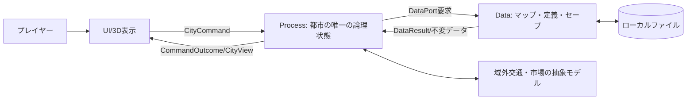
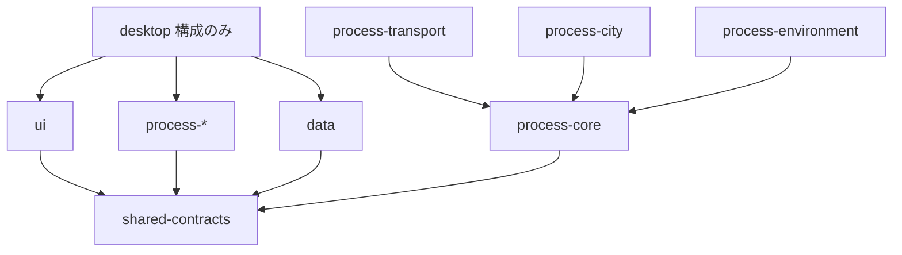
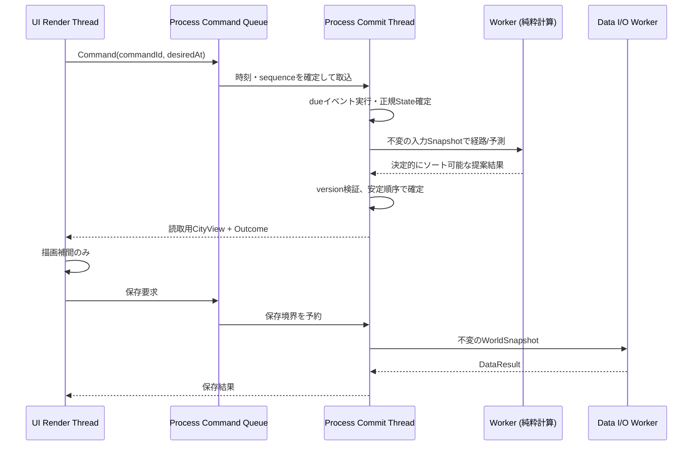

# 2. システムアーキテクチャ（CB-SDD-02）

> 目的：UI/Process/Dataの責務、データの流れ、JVMの実行環境とモジュール構成を、実装・レビューできる形で定義する。[技術構成](../TECH_STACK.md) と [JVMコンポーネント設計案](../JVM_COMPONENT_DESIGN.md) を具体化する。ライブラリの採用確認は #67/#68 で行う。

## 2.1 コンテキスト図



**域外モデルもProcess内のゲームルール**であり、外部ネットワーク通信を前提としない。UIがDataに直接アクセスする経路は設けない。

## 2.2 UPDの境界と判断責務

| 層 | 含まれる責務 | 決めてはいけないこと |
| --- | --- | --- |
| UI | 入力、ウィンドウ、3D描画、カメラ、UI演出、表示補間、音声、情報レイヤー表示、操作プレビュー | 建設可否、税、信号通過許可、人口変化、保存内容の正当性 |
| Process | コマンド検証、正規WorldState、交通/経済/電力などのルール、イベント確定、集団管理、サービス容量、表示用Snapshotの作成、保存の開始判断 | GPU/GUI操作、ファイル読書き、独自のData形式解釈 |
| Data | マップ・設定・セーブの読込/書込、スキーマ/CRC/形式検証、圧縮、I/O障害報告、アセット原データ取得 | ゲームルールによる合否判定、画面表示、都市のState遷移 |

UIのプレビューはProcessの**非確定の評価結果**を表示する。Processが保存すべきと決め、Dataが保存する。DataがI/Oエラーを返したら、Processが再試行可否を判断し、UIが通知する。

## 2.3 JVMマルチモジュール構成案

```text
city-builder/
  shared-contracts/     公開される不変の型/値/ポート定義のみ
  process-core/         ID・State・イベント・容量・SimClock・ルールエンジン
  process-transport/    有向グラフ・経路/歩道/車/鉄道/乗降
  process-city/         住民/建物/企業/公共サービス/経済/政策
  process-environment/  電力・水・気象・汚染・災害
  data/                 アセット定義読込・セーブ/ロード・フォーマット
  ui/                   3Dシーン・カメラ・HUD・ツール・音
  desktop/              起動、構成、依存解決
  tests-headless/       Process単体・統合/再現性試験
  benchmark/            全件更新と共有計算の比較
```

**モジュール数は責務を表す論理分割**。最初の開発ではprocess系を統合してもよいが、パッケージ境界と依存ルールを守る。Java 21＋Kotlin、Gradle Kotlin DSL、libGDX/LWJGL3は初期採用案であり、固定バージョンと3OS可否は未検証。

依存の形：



データの永続化依頼はProcessが共有の`WorldStoragePort`へ出し、DesktopがData実装を注入する。DataはProcessの内部クラスをimportせず、共有値を扱う。**共有モジュールは第4の処理層ではない**ため、ゲームルールを置かない。`desktop`も都市計算を行わない。

## 2.4 Process内部の役割と所有関係

| 担当（役割） | 所有/変更できるもの | 依存 |
| --- | --- | --- |
| `WorldCoordinator` | コマンドとdueイベントの処理順調整のみ | 各小さな担当への移譲 |
| `EntityRegistry` | IDの生成/存在/明示的な終了 | 外部可変状態を公開しない |
| `EntityStateStore` | 個体の正規State・所属先・次の行動 | ID検証 |
| `GroupMembership` | 共通計算の派生索引/分割/統合 | 正規Stateから一貫して導出 |
| `SimClock`/`EventQueue` | 論理時刻・イベント順序・取消 | 時刻と版、stableSequence |
| `MovementPredictor`/`GroupArrivalIndex` | 進捗法則・集団内の到達順 | 区間/移動ルール |
| `BoundaryResolver` | 進入可否・State切替判断 | 境界条件・容量の読み取り |
| `CapacityLedger`/`TransitionCommitter` | 予約/確定/解除・正規状態移管 | 原子的な確定操作 |
| 各DomainManager | 道路・建物・住民・電力などその分野の正規状態 | ドメイン変更通知/契約 |
| `WorldProjector` | 読み取り専用のCityViewを構築 | 確定済みSnapshot |
| `WorldStoragePort` | Processが要求する保存/読取の型契約のみ | Dataアダプタに処理を移譲 |

**万能クラスは禁止**。`WorldCoordinator` はゲームルールを直書きせず、各担当へ処理を移譲する。具象クラスはfinal、継承可能な契約はinterface/abstractのみ、独自オーバーロード禁止。独立した判断処理を1関数に詰め込まない。

## 2.5 実行スレッドと同期点



- **唯一の正規State書込主体：Process Commit Thread**。UI、Data、Workerはそれを直接変更しない。
- 高負荷計算は不変Snapshotから並列に予測可能。ただし結果を適用するときに対象revisionを再検証し、失効した提案は再計算する。
- Workerの終了順がstableSequenceや入場順になることは禁止。確定は入力時刻・優先度・決定的ID順に従う。
- UIは確定したStateの投影だけを描画。実際の通行許可・税収・事故等を描画スレッドで変更しない。
- I/O中にProcessを長時間ロックしない。セーブ用の不変Snapshotを確定境界で切り出し、Dataが書いている間のプレイ進行と所有権を分ける。Snapshot生成負荷は別計測。

## 2.6 コマンドと読み取りの往復

1. UIが`PlaceRoadCommand`等を発行。入力固有の`commandId`と期待する地形/ネットワークrevisionを添える。
2. Processが形式・権限・資金・接続・Stateを検証。
3. 成功なら**元帳・地形/道路・対象revision・失効イベント**を一つの確定単位として適用。
4. `CommandOutcome`で成功/拒否理由と更新版を返す。UIは確定後のCityViewだけ表示する。
5. UIが同じcommandIdを再送しても、既確定要求は二重実行しない（少なくとも処理中と受信ウィンドウ内の冪等性）。ロード後の入力ログリプレイは別に管理する。

## 2.7 観測・ログ・性能

Processはゲーム時間、処理イベント件数、Group数、失効予約件数、影響区間数、1イベント処理時間、キュー長、待機ID数を計測。Dataはセーブ量/CRC/書込秒数/エラー、UIはFPS/draw calls/表示インスタンス/GPUの指標を持つ。

これらは検証とデバッグ用の観測値。**観測自体がProcessのStateや乱数消費順を変えてはいけない**。ログのファイル書込はDataまたは診断用外部アダプタに委譲し、Process内でI/Oしない。

## 2.8 設計レビューの合格条件

- UI→Dataの直接アクセスがない。Dataはゲームルールを判断しない。
- 各モジュールの外部APIが具体クラスの継承や公開可変配列を要求しない。
- 描画OFFでも同じProcessコマンドとイベントで進行できる。
- コマンド・非同期結果・ロード時のエラーがProcessを経由してUIへ届く。
- 正規状態の同時書込はなく、ワーカー完了順で論理結果が変化しない。
- 全てのコードが `CODING_RULES` の必須規約へ適合する。
