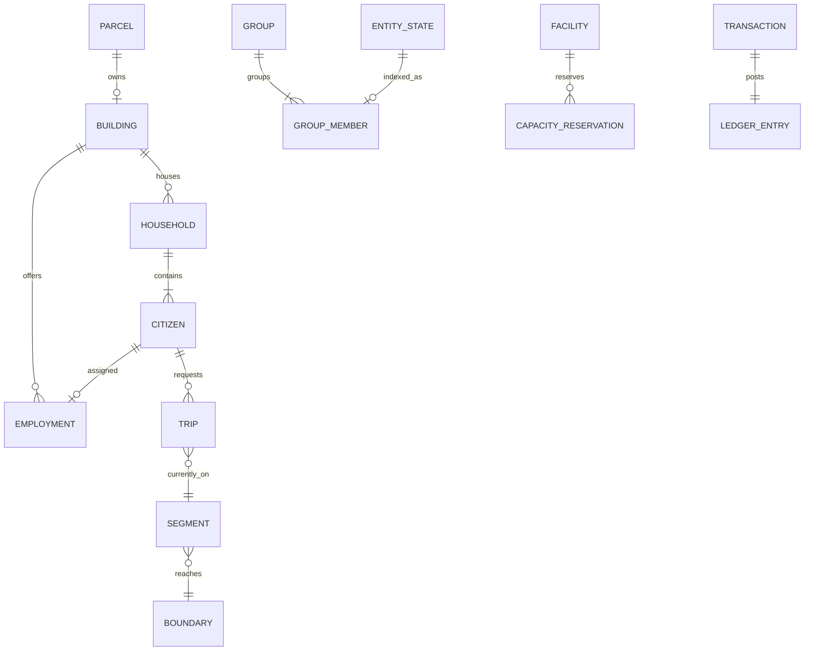

# 3. データ・ドメインモデル（CB-SDD-03）

> 目的：個体の同一性、計算集団、移動、都市機能、数量と保存単位を明確にし、実装者が参照整合性を崩さない設計にする。厳密な実行順序は [RUNTIME_PROTOCOL](../RUNTIME_PROTOCOL.md) を優先。

## 3.1 ドメインの概念図



これは**論理的な関連**を表す。EntityごとにORMの行またはJVMオブジェクトが必要という意味ではない。配列・セグメント別索引・行指向/列指向などはテストで比較できる。

## 3.2 ID体系と参照規則

| 識別子 | スコープ/型候補 | 保持/再利用 | 用途 |
| --- | --- | --- | --- |
| `EntityId` | 都市内で一意の正整数 `Long` | **再利用しない**、生成カウンタをセーブ | 住民・車両・建物などゲーム上の実体 |
| `CitizenId`/`VehicleId`/`BuildingId` | 型安全なAPI上の別名・値型 | 物理IDの一意性を守る | 誤った種別の参照を防ぐ |
| `HouseholdId`/`FirmId` | 都市内で一意の `Long` | 存在中の所有者を持つ | 世帯・企業との継続的な関係 |
| `SegmentId`/`BoundaryId`/`NodeId` | 有向ネットワークごとに安定 | 編集時はrevision更新、撤去IDを別区間へ再使用しない | 道路/歩道/鉄道の接続 |
| `TripId`/`ShipmentId` | 行動単位で一意 | 完了後は履歴化/破棄可、同時有効な再利用なし | 通勤・旅行・貨物 |
| `GroupId` | Process内部の派生索引のID | **永続的な同一性は要求しない**。保存時に再構築可能 | 共通処理を受けるIDの集合 |
| `EventId`/`ReservationId` | イベント/予約単位で一意 | 未完了の間は再利用せずセーブに必要 | 失効・二重確定の防止 |
| `CommandId`/`TransactionId` | 入力/確定取引単位で一意 | 冪等性ウィンドウまたは元帳として保持 | 二重配置・二重課税の防止 |
| `CauseId` | 変更連鎖単位 | 診断・通知に記録 | 「何が原因で変わったか」を追跡 |

IDの数値に種別や位置をエンコードしない。型別の連続配列を使っても、**IDと配列オフセットは異なる概念**として扱う。削除/移転/圧縮時の対応表を管理する。

## 3.3 正規Stateと派生データ

**正規の状態（Processが所有）**：

- 個体の有効性・種別、所属世帯/施設/区間、ライフサイクル。
- 進行中の移動の区間・進路・開始時刻・位置アンカー・移動規則のrevision。
- 建物/企業/施設の稼働状態・定員と確定した予約。
- ネットワークグラフ・地形・区画・コンテンツ版・会計元帳。
- 予定イベント・待機購読・容量予約・乱数状態・論理時刻。

**再構築できる派生情報**：

- `GroupMembership`、区間→Groupの逆引き、施設→待機群の索引。
- ある時点の交通情報レイヤー、地区別の集計、視界内のIDリスト。
- レンダリング用proxy、メッシュ、テクスチャ、可視範囲キャッシュ。

派生データをキャッシュ/セーブして高速化してもよいが、正規データとrevisionが一致しなければ**破棄して再構築**する。UIのカメラ位置を再計算の原因にしない。

## 3.4 個体移動の最小データ辞書

### `MovementRecord`（Process正規の一部）

| フィールド | 型候補/単位 | 必須 | 意味 |
| --- | --- | --- | --- |
| `entityId` | EntityId | 必須 | 移動主体 |
| `mobilityState` | StateCode | 必須 | 歩行、横断待機、横断中、走行、乗車中、待機 |
| `ownerLocation` | LocationRef | 必須 | 現在占有する1つの区間/施設/待機場所 |
| `routeId` | RouteId? | 任意 | 有効な共有経路。必要なら再探索 |
| `nextBoundaryId` | BoundaryId? | 移動中 | 次の判定地点 |
| `enteredAtMs` | Longミリ秒 | 移動中 | その移動規則の開始時刻 |
| `anchorProgress` | 整数/固定小数の0..1 | 移動中 | 規則変更時の区間内進捗 |
| `travelModelId` | RuleId | 移動中 | 共通の速度/時間計算規則 |
| `travelRevision` | Long | 移動中 | 予測に使用した版 |
| `expectedArrivalMs` | Long | 予測済 | 次の境界へ到着する予定時刻 |
| `stateRevision` | Long | 必須 | 古いEvent/Requestを弾く |
| `waitKey` | WaitKey? | 待機中 | 解除条件を購読する場合 |

`ownerLocation` は **「まだ元区間にいる出口待機」**と **「次区間へ移管済」**を区別する。車が下流で詰まっている間は上流区間の滞在容量を占有し続ける。横断歩道入口で待つ歩行者は歩道側の待機位置/入口バッファに属し、横断歩道内の占有者として計上しない。

### 交通と生活のStateは直交する

| 個体 | 移動State | 活動State | 他の所属 |
| --- | --- | --- | --- |
| 市民104 | `CrosswalkWaiting` | `Commuting` | 世帯21、勤務先220 |
| 市民105 | `RidingBus` | `Commuting` | 世帯28、勤務先245、バス車両92の乗客席 |
| 車両92 | `Driving` | 運行中 | バス路線4、現在道路区間14 |
| 市民106 | `AtHospital` | `UnderTreatment` | 世帯30、病床予約ID490 |

**勤務先があることと、現在そこに物理的にいることは別**。入居・雇用・病床・乗車などの関係を別の契約で管理する。

## 3.5 Groupモデル（派生索引）

`GroupKey`の初期構成：

```text
GroupKey(
  entityKind,
  mobilityState,
  segmentId / facilityId,
  travelModelId,
  travelModelRevision,
  nextBoundaryId,
  conditionClass
)
```

- GroupIdは派生索引であって永続IDではない。所属ID集合と個別の進路・開始時刻を保持し、別の移動条件なら分割する。
- GroupMembersはIDの集合に加え、到達時刻別のインデックスを持つ。**同じGroupにいる全員が同時に到着するという意味ではない**。
- グループの共通計算法と、各IDの状態確定のコストを混同しない。
- 分割/合流は原子的。入力集合と結果の集合が一致することをテストする。
- 移動集団の共有は全Domainに一つの固定所属を要求しない。人口・買物・税・通信は目的に応じて別の集計索引を使う。

## 3.6 ネットワーク・境界モデル

| モデル | 重要項目 | 所有者/不変条件 |
| --- | --- | --- |
| `NetworkNode` | NodeId、座標、道路/歩道/鉄道種別 | 接続点でなければ見た目の交差だけで通行不可 |
| `Segment` | SegmentId、from/to、距離、速度/容量、方向、revision | 方向に従う。移動中IDの占有を把握 |
| `Boundary` | BoundaryId、元/先Segment、合法State、信号/優先/入場規則 | State不一致はTransition、物理的通行不可はWait |
| `ConflictZone` | ZoneId、共有する進入元、排他/優先、占有・予約数 | 車と横断者の同時排他を一元判定 |
| `Route` | RouteId、通行モード、有向Segment列、版/コスト | 不通になったら失効し、影響Tripのみ再探索 |
| `WaitKey` | 対象境界/施設、待機理由、条件版 | 変化時に再評価。青だけで全員進入可としない |

道路・鉄道・歩道のネットワークは**独立した接続関係**を持つが、駅入口・駐車・乗換等の明示したTransferBoundaryで結合する。

## 3.7 都市と経済の正規モデル

| 領域 | 主な情報 | 主要な不変条件 |
| --- | --- | --- |
| マップ | 地形チャンク、区画セル、ParcelId、標高、水域ID、資源 | 同じ敷地の占有建物は一意 |
| Building | BuildingId、テンプレートID、ParcelId、LifecycleState、レベル、住戸/職枠、供給状態 | 建築中の定員は使用不可 |
| Household/Citizen | 世帯所属、住居、年齢/職業、活動と移動 | 有効CitizenIdが人口の正 |
| Firm/Employment | FirmId、BuildingId、JobSlot、従業員ID | 一つの職枠に同時に重複採用しない |
| Transit | Route/Trip/Vehicle/StopID、座席予約、運行State | 満員時に乗客IDを二重乗車させない |
| Utility | 施設ID、ネットワーク成分、容量・需要・実供給、状態版 | 供給量と不足量は需要との整合を保つ |
| Inventory | 商品カテゴリ、在庫、製造バッチ、ShipmentId、在庫元帳 | 二重出荷・二重販売なし |
| Treasury | TransactionId、PeriodId、残高、税基礎、支出/借入 | 元帳の収支和と残高が一致 |
| Environment | 地区/汚染セル、濃度、排出/流出/吸収、変更版 | 瞬間的な負値/無限増加を防ぐ |
| Disaster | IncidentId、影響ID、損傷・避難/復旧State | 災害で施設IDが黙って消えない |

**単位の例**：速度m/SimClock秒、距離m、時刻ms、電力kWh/ゲーム日、上水m³/ゲーム日、排水m³/ゲーム日、ごみkg/ゲーム日、通貨Creditの1/100、定員は整数人/住戸/車両等。単位を混ぜるAPIは作らない。演算や丸め方は [QUANTITATIVE_MODEL](../QUANTITATIVE_MODEL.md) の規則へ従う。

## 3.8 変更の伝播と逆引き索引

| 変更源 | 索引で探す対象 | 必ず確認すること |
| --- | --- | --- |
| RoadSegment改造/閉鎖 | Segment→移動中Group、Route→Trip | 位置の再アンカー、旧予約失効、再ルート |
| 信号位相 | Boundary→WaitKey、ConflictZone→待機群 | 影響する入場要求のみ再評価 |
| 建物完工/閉鎖 | Building→居住世帯/企業/JobSlot、影響地区 | 入居定員、就業、税、需要の差分 |
| 送電/水道停止 | 接続成分→供給対象BuildingId | 供給/需要の再計算・二重通知防止 |
| 税率/政策変更 | District→税基礎/建物/住民群 | 変更前期間の会計を確定後に新率適用 |
| 災害/汚染 | 空間セル→建物/道路/インフラ | 対象のみ失効/再評価 |

大規模な逆引きは長寿命・安定した索引で保持し、更新差分とrevisionで更新する。毎フレームの全都市スキャンは禁止ではないが、**明示的な根拠と性能試験なしには採用しない**。

## 3.9 保存・読取・可視化に渡す形

- Process→Data：正規状態のスナップショットまたは版付きレコード。mutableな所有配列を直接手渡さない。
- Data→Process：読込結果とバージョン/整合事実。ゲームルールによる適格判定はProcessで行う。
- Process→UI：時刻/版付きの読み取り専用`CityView`。描画の対象と集計指標を含むが、内部の索引やメモリのポインタを見せない。
- GroupIdや描画Proxyの内部IDをセーブやユーザー向けの永続参照へ使わない。

## 3.10 データモデルの受入試験

1. 住民1,000IDを分割・統合してもID集合と世帯参照が一意。
2. 道路区間が満員の場合、出口待機車は元区間に残り、占有合計が正しい。
3. 市民104が通勤中でも勤務先・住所が保持される。
4. 建設中の建物へ入居要求しても受理されず、完工後には定員が有効。
5. ID/参照/容量の不一致があるセーブをロード拒否し、稼働中の世界を維持。
6. 全派生索引を破棄し再構築しても、正規状態・会計・交通の結果が同じ。
