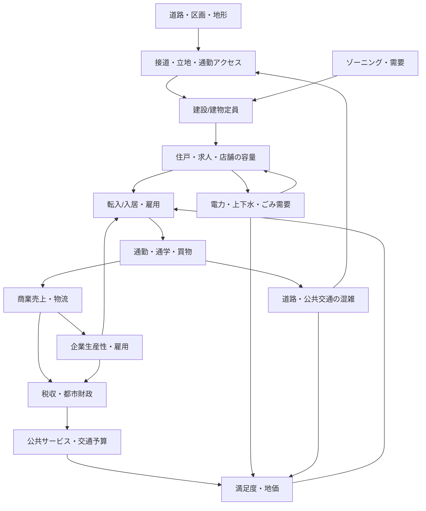
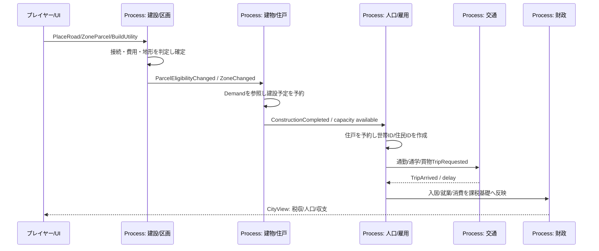

# 5. 都市機能の統合・業務フロー（CB-SDD-05）

> この章は「街の各要素が、互いにどの情報を渡して影響するか」の実装設計。ゲームルールの詳細な数値は [QUANTITATIVE_MODEL](../QUANTITATIVE_MODEL.md)、完成時の挙動は [GAME_DESIGN](../GAME_DESIGN.md) と各分野文書、状態・イベントの語彙は [STATE_EVENT_CATALOG](../STATE_EVENT_CATALOG.md) を優先する。

## 5.1 全体の因果グラフ



循環の矢印は**同じ時刻に際限なく再計算するという意味ではない**。各Domainは確定した状態差分だけ発行し、派生計算は適切な時刻・位相・閾値・評価周期に従って実行する。

## 5.2 Domainが公開する最小の変更通知

| Domainの所有者 | 正規状態 | Domain Change（確定後） | 主な購読先 |
| --- | --- | --- | --- |
| Land/Network | Parcel/道路・歩道・外部接続 | `TerrainChanged`、`RoadGraphChanged`、`ParcelEligibilityChanged` | 建設、交通、地価、インフラ |
| Zoning/Building | 用途区画、BuildingId、建設Stateと容量 | `ZoneChanged`、`ConstructionCompleted`、`BuildingCapacityChanged`、`BuildingClosed` | 住宅、雇用、需要、ライフライン、税 |
| Population/Household | Citizen/Household、住所、年齢・就業 | `HouseholdMovedIn`、`EmploymentChanged`、`PopulationDistrictChanged` | 交通需要、商業、公共サービス、電力/水、税 |
| Transport | Trip、区間/車両、混雑/所要時間 | `AccessTimeChanged`、`TripArrived`、`RouteUnavailable` | 人口・雇用、商業、緊急サービス、地価 |
| Utility | 系統、施設、供給・需要・処理量 | `UtilityServiceChanged(component, affectedBuildings)` | 建物、産業、生活、公共サービス |
| Economy/Logistics | Firm、商品・在庫、Shipment、収支元帳 | `StockChanged`、`JobVacancyChanged`、`TaxBaseChanged` | 商業、建設、雇用、財政 |
| PublicServices | 施設定員、待機/対応中、サービス指標 | `ServiceCoverageChanged`、`FacilityUnusable` | 人口、建物、地価、災害 |
| Environment/Disaster | 汚染場、被害・修復State | `PollutionFieldChanged`、`DisasterDamaged`、`InfrastructureRestored` | 建物、交通、公共サービス、地価 |
| Treasury/Policy | 取引元帳、税率、予算、地区ルール | `BudgetChanged`、`PolicyChanged`、`FinancialPeriodClosed` | 施設稼働、税/需要、UI集計 |

Domain Changeは`causeId / sourceRevision / affectedIds-or-region / eventAt`を持つ。**表示通知のためだけにDomainからUIへ直接イベントを送らない**。Process内で集約した結果をCityViewに投影する。

## 5.3 E01：街の誕生（縦断フロー）



### 正規状態が変わる順序

1. UIの道路/区画/インフラ操作をProcessが検証し、地形/区画/元帳へ一度だけ確定。
2. 地区や敷地の**建築適性と用途需要**を評価。建築条件が揃った敷地へ`ConstructionPlanned`を予約。
3. 完工でBuildingIdの`Operating`化と住戸/雇用枠の追加。建設中の定員は利用できない。
4. **空き住戸予約成功後に限って**転入希望世帯を実際のHouseholdId/CitizenIdとして生成する。1住戸に2世帯を重複入居させない。
5. 求人・就学・施設アクセスに応じ勤務先/学校を割当。交通需要を発生し、目的地・時刻・交通手段を持ったTripへ。
6. 市民が通勤に成功/遅延すると、その事実だけが就業・満足度や企業生産性へ影響する。
7. 日次財政締めで確定済の税基礎と維持費を元帳に一回記帳し、都市の収支を更新。

**性能**：人口率・就職候補・建築適性は条件グループで共有。個別にIDが必要なのは入居/雇用/通行/乗車といった所属の確定時。毎フレームの全住民意思決定はしない。

## 5.4 E02：渋滞対策と交通手段の再選択

1. `TripRequested`を発生。OD（出発/到着）と時刻帯・交通手段で経路を共有計算し、各CitizenIdの出発時刻・行先を保持。
2. RoadSegmentの速度/占有と交差点の出入容量で到達時刻を予約。前区間で待つ車は現在区間の容量を占有し、上流の渋滞へつなぐ。
3. バス路線を追加すると、駅/停留所が接続できるODだけに「利用可能な別経路」を追加。運行便・乗換・料金・定員を比較する。
4. 大きなアクセスコスト改善があった対象Trip/世帯群だけ交通手段を再選択し、次回の通勤から反映。移動中のTripを突然テレポートしない。
5. 交通量・混雑・徒歩の到達時間・バス乗客数と財政運営費を再集計。地価/満足度へ遅延して影響。
6. プレイヤーはレイヤーで「待ちの原因」と新路線の効果を確認できる。

**不変条件**：同じCitizenIdは同じ時刻に徒歩+自家用車+乗車中として重複移動しない。車・バス・列車の定員/区間占有、信号・横断者の競合を無視しない。

## 5.5 E03：停電から断水・産業停止への連鎖

```text
GeneratorStopped / TransmissionDisconnected
  → PowerComponentRebalanced
  → AffectedBuildingIds PowerUnavailable
  → PumpStopped / FactoryLimited / MetroServiceLimited
  → WaterComponentRebalanced / ProductionRateChanged
  → AffectedCitizenGroups, FirmGroups, TransitTripGroups
  → Demand/TaxBase/ServiceScoreChanged
  → 次の評価時点で満足度・転入と財政へ反映
```

- 電力は接続成分の需要量と発電出力を**同じ時刻に集約**して割当。停止した全建物を毎フレーム更新しない。
- 停電したポンプは実給水量を減らす。上水需要だけを勝手に満たしたことにしない。
- 工場の生産率変更では、**変更時刻までの旧生産量を確定**して新しい率の完工予定を再予約する。
- 税基礎と需要変化は日次集計へ通知する。電力需要が減り、再び供給が回復する循環では同時刻の振動を防ぐヒステリシス/バッチ境界を設ける。
- 供給復旧時は関係する建物・ポンプ・企業だけを再評価する。

**代表試験**：100建物のうち20建物が別系統なら、片系統停止時は80/20など実際の接続成分に従って対象を分ける。停電→断水→工場停止→需要低下の因果経路と発行回数を記録し、無限通知を起こさない。

## 5.6 生産・輸送・商業

| 段階 | 所有Domain | State・条件 | 保存する数量 |
| --- | --- | --- | --- |
| 原材料の確保 | Firm/Inventory | `StockReserved`、不足なら`WaitingForInput` | 元材料・予約済量 |
| 生産開始・完工 | ProductionBatch | `Producing→BatchComplete` | 製品・消費原料・時刻 |
| 出荷依頼 | Logistics | `ShipmentRequested→Reserved` | ShipmentId・数量・積載車両 |
| 車両移動 | Transport | 道路/貨物駅の移動State | 車両/貨物の所在と到着予定 |
| 納品 | Logistics/Inventory | `Delivered`、倉庫/店へ受入 | 在庫移管・受入量 |
| 商業販売 | Shop | `SaleConfirmed` | 商品減、売上・課税基礎増 |

**数量保存**：期首在庫＋生産＋入荷－販売－廃棄－出荷＝期末在庫。発送済みの商品は受け取り先の在庫へ納品が確定するまで移さない。貨物トラックが画面外でも配送イベントは進む。

## 5.7 医療・学校・消防と通行容量の共有

- **学校**：入学時に年齢/通学アクセス/空き定員を判断。満員なら別校候補または`EnrollmentWaiting`。進級・卒業はゲーム暦イベント。
- **病院**：発病イベントで患者IDだけ生成/状態変更。病床・診療枠・救急車を予約。到着時刻が遅れた場合は医療結果へ影響。
- **消防**：火災イベントでIncidentIdを生成。消防車を一意に配車し、道路交通の待機・信号・閉鎖規則へ従わせる。道路/水道の停止が被害量へ影響する。
- **警察**：地区の治安リスクは集団計算、発生事件だけIncidentIdを保持。出動車両が同時に二つの事件を引き受けない。
- **公園/観光/葬祭**：施設の開園・来訪・搬送・待機等をイベントと容量で管理し、需要を地区で集約する。

施設ごとの**ゲームルールはDomain自身が担当**。共通化するのはIDの移管、WaitKey、予約/確定、通知の仕組みまで。施設ごとに万能なStateを一つだけ押し付けない。

## 5.8 地区政策・税率・幸福度への影響

- 地区ポリシーの変更は対象区域と適用時刻を持ち、影響する建物/会社/経路群のrevisionを更新。
- 税率変更は**変更前の期間の基礎額を旧税率で積算して確定**し、変更後の期間だけ新税率を使用。
- 住民満足度・地価・転入は低頻度の指数平滑化/閾値の継続日数で評価し、信号一回の変化で大量転出しない。
- 収支は取引IDで冪等。予算不足が建設失敗となった場合、施設を建てたことにも元帳へ支出したことにもしない。
- UIはどの政策がどの地区に作用し、変化した指標の要因を表示する。

## 5.9 通知の重複・循環・遅延対策

| 問題 | 設計上の対策 |
| --- | --- |
| 1停電で建物1000件が同じ警告を発行 | `CauseId`と系統IDで警告を集約。UIは影響建物数を表示 |
| 電力↔水ポンプの供給停止が繰り返し発生 | 再評価時間窓、版番号、変更閾値、ヒステリシス、microRound監視 |
| 一つの建物完工が住戸と雇用枠を二重更新 | 各DomainがイベントIdで冪等に確定し、1つの確定差分から派生 |
| 未関係の遠方地区まで再計算 | 地区/敷地/接続成分の逆引き索引で対象限定 |
| 画面外の工場の生産が進まない | 生産完工・材料到着などの予定イベントがSimClockで進む |
| 送配電/公害の更新回数が爆発 | 同じ時刻・同じ影響地域の差分をバッチ化し、評価周期と最大反復を明示 |

## 5.10 都市ドメインの受入試験

1. 新規都市→基本インフラ→住宅完工→世帯入居→就業→通勤→販売→日次決算のE2Eが成立。
2. 建物の住戸100へ101世帯要求したとき、100だけ確定、残り1はWait/別施設に分類。
3. バス50席に50人乗車済みなら51人目は次便へ待機、乗客IDは重複しない。
4. 停電で工場が止まり、生産・貨物・税に影響。復旧で適切な時刻から再開。
5. 地区の税率変更で他地区に旧版が残る/誤って新税率を適用しない。
6. カメラ・画質の変更が、人口・道路混雑・電力・税収・汚染の**正規結果**に影響しない。
7. 保存→ロード→同一seed/入力で、各Domainの状態とイベント確定結果が一致する。
